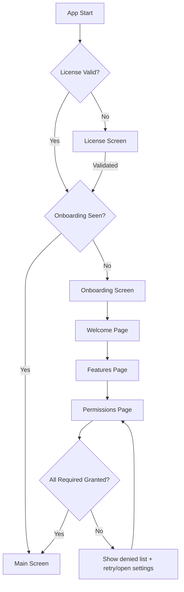
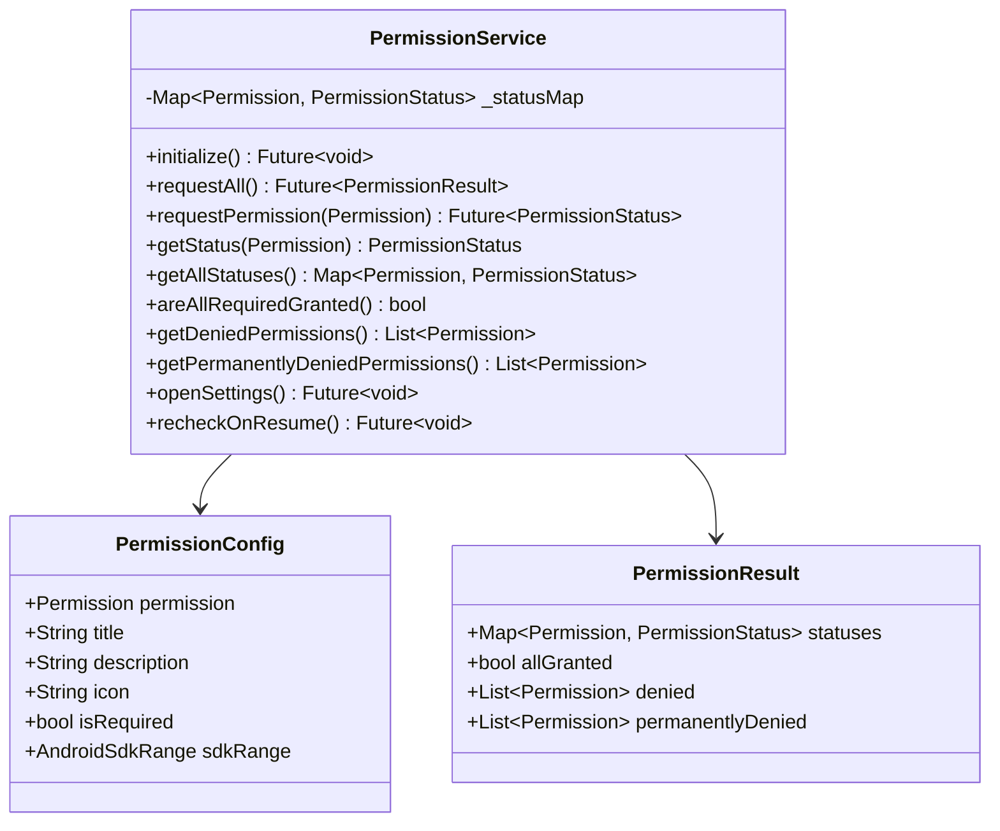
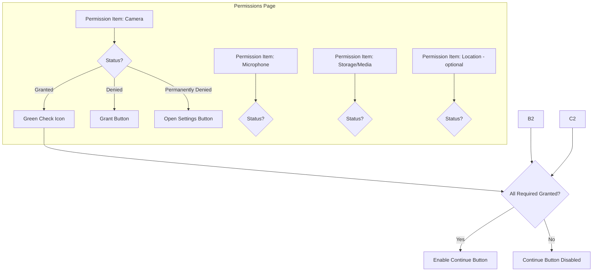

# Plan: Improve Onboarding & Permission Management

## Current Architecture Analysis

### Onboarding Screen (`lib/screens/onboarding/onboarding_screen.dart`)
- 3 pages: Welcome → Features → Permissions
- Uses `PageView` with `PageController`
- Permissions page has a single "Conceder permisos" button
- After requesting, sets `_permissionsGranted = true` **without verifying actual status**
- "Comenzar" button is **always enabled** — no guard to ensure permissions are granted
- No individual permission status tracking or visual feedback per permission
- No way to re-request denied permissions from onboarding

### PermissionService (`lib/services/permission_service.dart`)
- Only handles Android — iOS is silently skipped
- Sequential permission requests — stops on first denial
- Uses `print()` instead of `LoggingService`
- Creates new instance each time — no state persistence
- No method to check current permission status without requesting
- No method to get a summary of all permission states
- `requestPermissions()` requires `BuildContext` — tight UI coupling for dialogs
- Dialogs are embedded in the service — mix of concerns

### Duplication Across Services

| Service | Permission Logic | Lines |
|---------|-----------------|-------|
| `PermissionService` | Full Android SDK-branching, media/storage/camera/mic/location | 7-37 |
| `StorageService._getRecordingDir()` | `Permission.storage.request()` in a while loop | 24-26 |
| `MediaStoreService._requestPermissions()` | Android SDK check + `Permission.videos` / `Permission.storage` | 43-67 |
| `main.dart didChangeDependencies()` | Calls `_permissionService.requestPermissions(context)` again | 321-329 |

### AndroidManifest.xml Issues
- Declares both legacy and new media permissions — correct for backward compat but no runtime gating
- `MANAGE_EXTERNAL_STORAGE` declared — broad permission, needs Play Store justification
- `NEARBY_WIFI_DEVICES` declared for Android 13+ WiFi — OK but not requested in PermissionService

---

## Identified Problems

1. **No centralized permission state** — each service checks/requests independently
2. **Redundant permission requests** — user gets prompted multiple times for the same permission
3. **No permission status tracking** — no way to know which permissions are granted/denied at any point
4. **Onboarding allows skipping** — "Comenzar" works without granting any permissions
5. **No iOS support in PermissionService** — iOS permissions silently ignored
6. **UI/Service coupling** — PermissionService shows dialogs directly
7. **No graceful degradation** — app does not handle partial permission grants
8. **Inconsistent logging** — `print()` instead of `LoggingService`
9. **No permission re-check on app resume** — permissions can be revoked from settings
10. **Bottom bar UX is confusing** — "Siguiente" and "Comenzar" both visible on all pages

---

## Proposed Architecture

### Flow Diagram



### Permission Service Redesign



### Onboarding Permissions Page Redesign



---

## Implementation Steps

### Phase 1: Refactor PermissionService

1. **Create `PermissionConfig` model** — define each permission with metadata: title, description, icon, isRequired, SDK range
2. **Rewrite `PermissionService` as a singleton with state** — store a `Map<Permission, PermissionStatus>` that persists across the app lifecycle
3. **Add `initialize()` method** — check all current statuses without requesting, populate the map
4. **Add `requestAll()` method** — request all required permissions, return a `PermissionResult` object
5. **Add `areAllRequiredGranted()` and `getDeniedPermissions()`** — query methods for UI
6. **Remove dialog logic from service** — return status results and let the UI layer decide how to handle denials
7. **Replace `print()` with `LoggingService`**
8. **Add iOS support** — request camera, microphone, photos permissions on iOS
9. **Add `recheckOnResume()`** — hook into app lifecycle to re-check permissions when app returns from settings

### Phase 2: Remove Permission Duplication

10. **Remove permission logic from `StorageService._getRecordingDir()`** — rely on centralized `PermissionService` instead
11. **Remove `_requestPermissions()` from `MediaStoreService`** — check `PermissionService.areAllRequiredGranted()` before saving
12. **Remove redundant `_permissionService.requestPermissions(context)` from `main.dart didChangeDependencies()`** — permissions are handled in onboarding

### Phase 3: Redesign Onboarding Permissions Page

13. **Create individual permission item widget** — shows icon, title, description, status badge, and action button
14. **Replace single "Conceder permisos" button with a list of permission items** — each with its own grant/settings button
15. **Add real-time status updates** — after each permission request, update the UI immediately
16. **Disable "Comenzar" button until all required permissions are granted**
17. **Add "Omitir" option for optional permissions** — like location, which is only needed for WiFi features
18. **Improve bottom bar UX** — hide "Siguiente" on last page, hide "Comenzar" on non-last pages

### Phase 4: Add Permission Re-check on App Resume

19. **Add `WidgetsBindingObserver` to `MyAppState`** — detect app resume from settings
20. **On resume, call `PermissionService.recheckOnResume()`** — update status map
21. **If critical permissions were revoked, show a warning dialog** — prompt user to re-grant

### Phase 5: AndroidManifest Cleanup

22. **Add `android:maxSdkVersion="32"` to legacy storage permissions** — `READ_EXTERNAL_STORAGE` and `WRITE_EXTERNAL_STORAGE` are not needed on Android 13+
23. **Verify `NEARBY_WIFI_DEVICES` is requested in PermissionService** for Android 13+ WiFi features
24. **Add comment annotations** for each permission group explaining its purpose

---

## New File Structure

```
lib/
  services/
    permission_service.dart          # Refactored: singleton, stateful, no UI
  models/
    permission_config.dart           # NEW: permission metadata model
    permission_result.dart           # NEW: permission request result
  screens/
    onboarding/
      onboarding_screen.dart         # Refactored: improved UX
      widgets/
        permission_item_widget.dart  # NEW: individual permission row
```

---

## Key Design Decisions

| Decision | Rationale |
|----------|-----------|
| PermissionService as singleton | Ensures single source of truth for permission state across the app |
| Remove dialogs from service | Separation of concerns — service returns data, UI decides how to present it |
| Required vs optional permissions | Location is only needed for WiFi — should not block onboarding |
| Disable "Comenzar" until granted | Prevents users from entering the app without critical permissions |
| Re-check on app resume | Users can revoke permissions from system settings while app is in background |
| SDK-gated permission configs | Avoids requesting permissions that do not exist on the current Android version |
